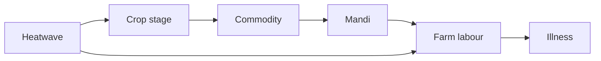
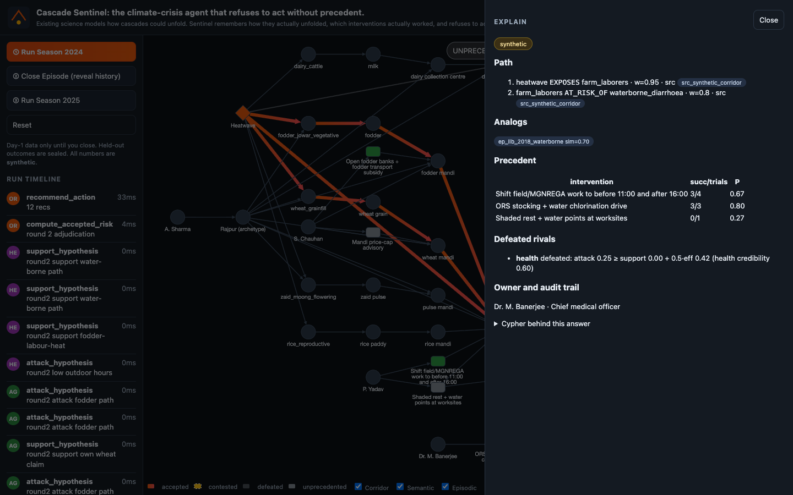
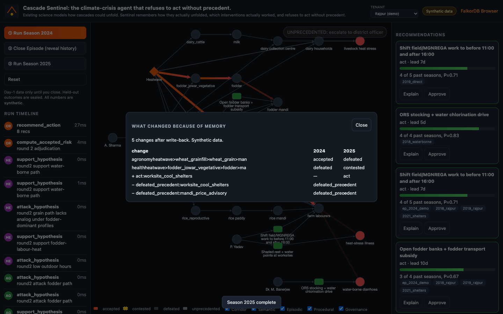

# I built an AI agent that refuses to act without precedent, using FalkorDB as its judge, memory, and conscience.

I spent a hackathon weekend on a climate-crisis agent that is allowed to say no.

The headline is: **Cascade Sentinel: the climate-crisis agent that refuses to act without precedent.**

The one-liner I kept repeating to myself, and later put on the top bar: existing science models how cascades *could* unfold. Sentinel remembers how they *actually* unfolded, which interventions actually worked, and refuses to act without precedent.

This is a build log, not a victory lap. The data are synthetic archetypes. The math is small. The graph is the product.

## The cascade problem

A heatwave is not a health event on day one. It is a crop-stage event, then a fodder event, then a mandi-price event, then a labour-hours event. About three weeks later the same chain shows up as heat-stress illness and water-borne disease.

Each department sees one link. Agriculture sees yield. Markets see prices. Labour sees attendance. Health sees the ward. By the time the health time-series moves, the cheap windows — shift work hours, open a fodder bank, pre-position ORS — closed 15 to 45 days earlier.

I did not invent a real district's IMD numbers, case counts, or mandi prices. Rajpur and Kalinagar are fictional. Every node in the shipped graph carries `provenance: 'synthetic'`. The day-one forecast fields that *should* be IMD values are literally `TODO_REAL_VALUE` with a fallback, and a SOURCES.md that says where to get the real ones. That constraint made the demo honest, and it made the graph do the talking.

## Why forward simulation isn't enough

A process-based crop model can tell you that grain fill hates 46 °C. It cannot tell you that the last four times this district opened a fodder bank during a May heatwave, two of those trials actually moved the mandi, and that a price-cap advisory failed twice and should stay struck through.

That is memory. It is also refusal. If the only path the agents can agree on has never been paired with a successful intervention, the system escalates: **UNPRECEDENTED: escalate to district officer.** It does not hallucinate a programme.

## One corridor as a typed, weighted graph

The causal template is a handful of labels and a handful of edge types. Weights, confidences, lag days, and a source sit on every meaningful relationship.

```cypher
MATCH (f:Forecast {id: $fid})-[:INSTANCE_OF]->(h:HazardType)
MATCH p = (h)-[*2..5]->(o:HealthOutcome)
WITH p, relationships(p) AS rels, nodes(p) AS ns
RETURN [n IN ns | n.id] AS ids,
       reduce(s = 1.0, r IN rels | s * r.weight * r.confidence) AS base,
       reduce(l = 0, r IN rels | l + coalesce(r.lag_days, 0)) AS lag
```

FalkorDB's `(h)-[rels*2..5]->` binding returned a Path, not a list, so the tool uses `relationships(p)`. That is the kind of thing you only learn by running the query.



A dairy branch sits in the same graph with no `(:Intervention)-[:TARGETS]->` on it. That branch is how the demo shows refusal. Grey path, pulsing badge, escalate. No invented action.

## Three memory layers

**Semantic** is who this tenant is. Rajpur is semi-arid, high landless share, fodder-dependent. Kalinagar is irrigated rice. Same corridor, different `GROWS.area_share`, different top paths. Tenancy is one FalkorDB graph per district: `sentinel_demo` and `sentinel_district_b`.

**Episodic** is what happened. Closed library seasons 2018–2023, plus the live 2024/2025 episodes. Hypotheses live here. Agents write them. They do not write Cypher by hand; they emit tool calls.

**Procedural** is what we tried. Interventions carry `trials`, `successes`, `last_trial_year`. Precedent weight is a Python function, not a Cypher reduce, so the formula lives in one place and the graph stores the result.

## Adjudication in-graph

Three agents propose, then critique, through the same registry the MCP server uses.

Weather cares about timing windows. Agronomy is deliberately overconfident on wheat grain. Health cares about outdoor hours and, in season N, about the fact that the grain path has not realized under fodder-dominant analogs.

A hypothesis is defeated when

\[
attack \ge support + 0.5 \cdot eff
\]

and accepted when

\[
eff + support - attack \ge 0.6
\]

otherwise it stays contested. Mutual same-path attacks have two stable models; the implementation judges weaker proposers first so a fallen rival cannot sink everyone. That is a choice, written in DECISIONS.md, not a theorem.



The Explain drawer is the conscience: hops with weights and source chips, analog similarity, precedent table, defeated rivals with the reason string, the officer who owns the district, and the Cypher.

## Refusal as a feature

Most agent demos are eager. This one is not allowed to invent an intervention for a path with no qualifying analog and \(P \ge 0.5\). Cool shelters start as a defeated precedent (one failed trial, decayed). After 2024's held-out success they flip to act. The dairy path never does. That is the point.

## The double-run backtest

Season 2024 sees only day-one forecasts. Close reads a sealed held-out file. Reconstruction Jaccard against the realized fodder path is 1.0, **PASS**. Agronomy takes a miss; weather and health take hits. Cool-shelter \(P\) moves 0.27 → 0.50.

Season 2025 is the same kind of forecast with a different memory. Agronomy's wheat claim is defeated (credibility 0.40). Cool shelters are recommended. Dairy is still UNPRECEDENTED. The diff panel lists those changes. A golden JSON file has to match twice in a row.



The LLM, when enabled, receives the tool JSON and may write a paragraph. Its text never feeds back into scores. Default provider is `none`.

The same 11 tools are an MCP server (`stdio` or streamable HTTP). Claude Desktop, or any MCP client, can ask for paths, recommendations, and explanations without a private REST dialect. Three example prompts live in the README. That is how the graph becomes a tool other agents can share, not a page only this UI knows.

## What I'd do with real data

1. Replace `TODO_REAL_VALUE` from IMD heatwave bulletins, not from my imagination.
2. Join IDSP weekly outbreaks and Agmarknet mandi series as `(:Episode)-[:OBSERVED]->` with `provenance: 'real'`.
3. Keep the refusal rule. Real data will create more UNPRECEDENTED paths, not fewer. That is useful.
4. Sit with a district cell for one season of write-backs. The graph only becomes a conscience if someone actually closes episodes.

## Lessons from building solo in 48 hours

The graph has to be the product. If you can delete FalkorDB and still demo, you built a chatbot with a graph sticker.

Determinism is a gift. A golden test that fails on timestamps will waste an hour you do not have. Freeze clocks. Round floats. Strip `ms`.

Seed design is the story. The cool-shelter flip is not an animation; it is `trials=1,successes=0` becoming `2/1` after close, then \(P=0.5\) in the next year.

Cytoscape will silently attach edges to the wrong node if you name a property `source` and also need `data.source` as the endpoint. Name the citation `cite`. I learned that from a screenshot of a vertical hairball.

And: an agent that refuses is more trustworthy than one that always has a card to show. The grey path is the feature.

---

*Cascade Sentinel. MIT. Synthetic data. FalkorDB as judge, memory, and conscience.*
