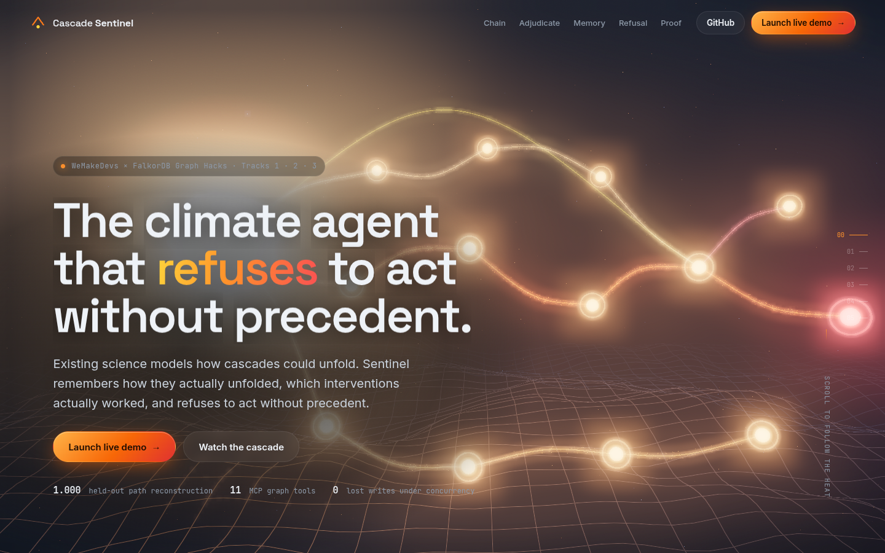
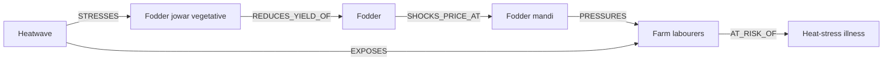
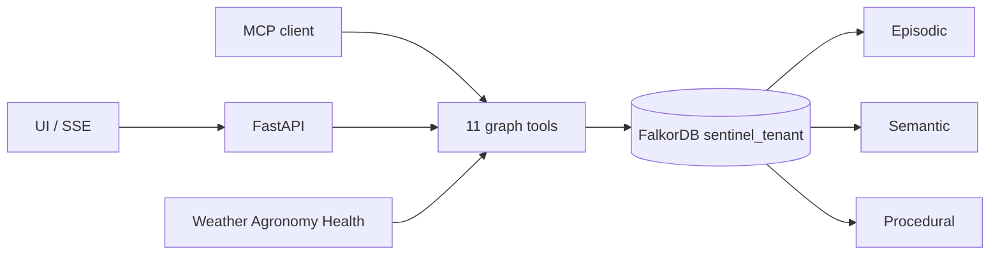
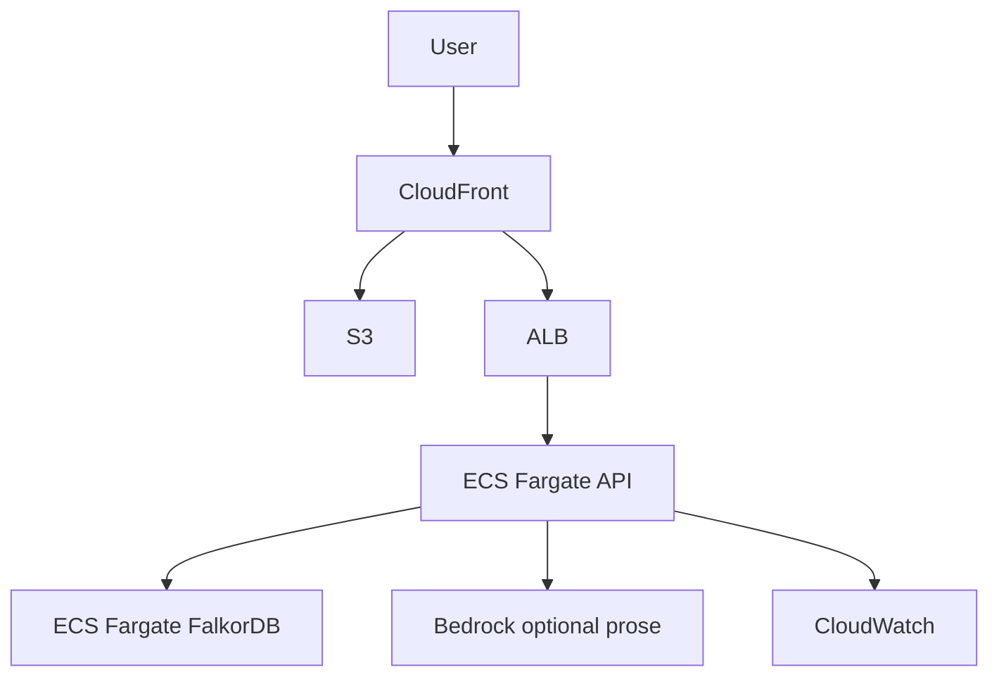

# Cascade Sentinel

**The climate-crisis agent that refuses to act without precedent.**

[](https://aneek22112007-tech.github.io/cascade-sentinel/)

**Live site:** https://aneek22112007-tech.github.io/cascade-sentinel/ (3D landing page) · **Replay demo:** https://aneek22112007-tech.github.io/cascade-sentinel/app/ · **Video:** _placeholder_ · **Repo:** https://github.com/aneek22112007-tech/cascade-sentinel

> The live site is static (GitHub Pages). `/app/` is the real dashboard replaying JSON recorded from real FalkorDB runs by `python -m sentinel.export_static`: Run 2024, Close Episode, Run 2025, What changed, Explain with Cypher, and the tenant switch. For the live graph, run it locally (60 s, below).

> Existing science models how cascades could unfold. Sentinel remembers how they actually unfolded, which interventions actually worked, and refuses to act without precedent.

## The 30-second pitch

**Problem.** Climate shocks become human crises through chains. A heatwave stresses a crop at a specific growth stage, that cuts fodder, prices move, debt-stressed farm laborers work longer in unsafe heat, and about 3 weeks later it shows up as heat-stress and water-borne illness. Each department sees only its own link in that chain, so by the time health data shows the signal, the cheap intervention windows 15 to 45 days earlier have already closed.

**Delta.** The first agent whose actions are compelled by precedent and whose hypotheses are adjudicated by the graph. Every recommendation traces to a multi-hop path and a written-back outcome.

**Graph-is-essential.** Remove FalkorDB and nothing is left. Every agent tool is a graph operation: traversal, precedent matching, adjudication, refusal, and write-back.

All district names are fictional. **Every shipped number is synthetic** (`provenance: 'synthetic'`), structured on the May 2024 north-India heatwave pattern. Day-one `tmax_c` / `anomaly_c` fields that should be IMD values are `TODO_REAL_VALUE` with a synthetic fallback. See [`sentinel/seed/SOURCES.md`](sentinel/seed/SOURCES.md).

## Quickstart

**60 seconds, no Docker** (Python 3.12+; embedded FalkorDB from the `falkordblite` wheel):

```bash
git clone https://github.com/aneek22112007-tech/cascade-sentinel && cd cascade-sentinel
python3 -m venv .venv && source .venv/bin/activate
pip install -e ".[dev,embedded]"
python -m sentinel.serve      # starts FalkorDB in-process, seeds both tenants, serves :8000
# landing http://localhost:8000/ · dashboard http://localhost:8000/app · health /healthz
python -m sentinel.backtest --tenant demo --double-run   # in a second shell
```

**Docker, single container:** `docker build -t cascade-sentinel . && docker run -p 8000:8000 cascade-sentinel`.
**Classic (FalkorDB in Docker Compose):**

```bash
pip install -e ".[dev]" && cp .env.example .env
make up && make seed && make demo          # http://localhost:8000
```

**Rebuild the GitHub Pages site** (records fresh runs from your FalkorDB): `python -m sentinel.build_pages --out site`. See [DEPLOY.md](DEPLOY.md).

If port 8000 is taken: `make demo PORT=8001`.

FalkorDB Browser: [http://localhost:3000](http://localhost:3000)

### No Docker?

Python 3.12+. Embedded Redis + FalkorDB via [FalkorDBLite](https://docs.falkordb.com/operations/falkordblite/falkordblite-py) — Unix sockets, no Docker daemon.

```bash
pip install falkordblite
# macOS: brew install libomp   # if libomp.dylib is missing
echo 'FALKORDB_LITE=/tmp/falkordb.db' >> .env
make seed
make demo
```

Skip `make up`. Seed, backtest, pytest, and the API use the same `select_graph` client against the embedded file.

```python
from redislite.falkordb_client import FalkorDB
db = FalkorDB("/tmp/falkordb.db")
```

Optional `SENTINEL_ADMIN_TOKEN` in `.env`: when set, mutating POST routes (`/api/{tenant}/reset`, `/run/{year}`, `/close/{episode_id}`, `/approve/{recommendation_id}`) require header `X-Sentinel-Token`. Leave it unset for local demo. The UI sends `localStorage.sentinelToken` when present.

```bash
make backtest      # double-run, PASS, memory diffs
python -m pytest -q
python -m sentinel.mcp_server --list
```

## How a cascade becomes a crisis



Lag along the fodder path is about three weeks. A dairy branch exists with **no targeting intervention** — that is the designed UNPRECEDENTED path.

## Architecture



**Production target (AWS)** — not what `docker-compose.yml` runs:



## Track map

| Judge criterion | Feature that proves it | Where shown |
| --- | --- | --- |
| Follow connections (multi-hop) | `enumerate_cascade_paths` ranks 3–5 hop cascades (top K) and lists 1–2 hop direct-exposure separately | UI path animation, Explain Cypher |
| Graph queries as agent tools via MCP | 11 MCP tools, all graph operations | [`sentinel/mcp_server.py`](sentinel/mcp_server.py) |
| Actions based on what the graph shows | `recommend_action` only with precedent; weak analog (amber) if analogs exist but cannot act; else UNPRECEDENTED | Recommendation cards, grey path |
| Explainable results | `explain()` path, analogs, rates, defeated rivals, Cypher, owner | Explain drawer |
| Remember across sessions | Double-run write-back | What-changed diff |
| Episodic / semantic / procedural | Labelled layers, legend toggles | Graph legend |
| Share state / handoffs | Shared hypothesis subgraph; `(:Run)-[:STEP]->` | Run Timeline |
| High-concurrency R/W | `bench/concurrency.py` | table below |
| Separate memory per tenant | `sentinel_<tenant>` graphs | Tenant switcher |
| Company brain | `(:Officer)-[:OWNS]->`, approvals | Explain owner |
| Keeping knowledge current | `close_episode` rewires weights + credibility | Diff panel |
| Answers with sources | Every edge `source`; `(:Source)` nodes | Explain chips |

## Graph model

**Labels.** HazardType, CropStage, LivestockStage, Commodity, Market, LaborGroup, HealthOutcome, District, VulnerabilityProfile, Forecast, Season, Episode, CascadePath, Agent, Hypothesis, Evidence, Intervention, Outcome, Recommendation, Officer, Team, Source, Run.

**Relationships.** STRESSES, REDUCES_YIELD_OF, SHOCKS_PRICE_AT, PRESSURES, EXPOSES, AT_RISK_OF, GROWS, HAS_MARKET, HAS_GROUP, HAS_PROFILE, INSTANCE_OF, FOR, MAY_TRIGGER, PROPOSED, ABOUT, ASSERTED, SUPPORTS, ATTACKS, TARGETS, HAD_OUTCOME, FOLLOWED_PATH, CONSIDERED, OBSERVED, OF, ESCALATED_TO, OWNS, MEMBER_OF, APPROVED, CITES, STEP, IN, TRIGGERED_BY.

Three memory layers in plain words: **semantic** is who this district is; **episodic** is what happened this season; **procedural** is which interventions have been tried and how they scored.

## Math (deterministic)

- Intensity \(I = \min(1, anomaly_c / 6)\)
- Timing \(T \in \{1.0, 0.6, 0.2\}\) from crop window vs forecast doy
- Exposure = `GROWS.area_share` × `HAS_GROUP.size_estimate` (area 1.0 on non-crop paths)
- Path score \(S = I \times T \times exposure \times \prod (weight \times confidence)\), top \(K=6\)
- Credibility \(C = (hits+1)/(hits+misses+2)\)
- Defeat if \(attack \ge support + 0.5 \cdot eff\); accept if \(eff + support - attack \ge 0.6\)
- Precedent \(P = ((successes+1)/(trials+2)) \times 0.9^{\max(0, year-last-1)}\)
- Act only if analog \(\mathrm{sim}\ge 0.5\) and \(P \ge 0.5\); else refuse

Same seed, same output. Golden test: [`tests/test_golden_backtest.py`](tests/test_golden_backtest.py).

## Talk to the graph from any MCP client

```bash
python -m sentinel.mcp_server --list
python -m sentinel.mcp_server                 # stdio
python -m sentinel.mcp_server --http 8765     # streamable HTTP
```

Claude Desktop `mcp.json`:

```json
{
  "mcpServers": {
    "cascade-sentinel": {
      "command": "python",
      "args": ["-m", "sentinel.mcp_server"],
      "cwd": "/absolute/path/to/cascade-sentinel",
      "env": { "FALKORDB_HOST": "localhost", "FALKORDB_PORT": "6379" }
    }
  }
}
```

Example prompts:

1. “Enumerate cascade paths for tenant `demo` episode `ep_2024_demo` and quote the Cypher.”
2. “Recommend actions for that episode. If a path is UNPRECEDENTED, do not invent an intervention.”
3. “Explain recommendation `<id>` including defeated rivals and sources.”

## Backtest

Day-one forecasts only. Held-out outcomes live in `backtest_heldout.json` and are read **only** by `close_episode`.

```bash
make backtest
# python -m sentinel.backtest --tenant demo --double-run
```

PASS means Jaccard(top accepted path, realized path) ≥ 0.6. Designed 2024→2025: agronomy miss, cool shelters flip to act, dairy stays UNPRECEDENTED.

## Concurrency

`python bench/concurrency.py` — 3 agents × 25 parallel proposals on `sentinel_demo`:

| proposed | stored | lost writes | ops/s (local) |
| --- | --- | --- | --- |
| 75 | 75 | **0** | 1386 |

## Honest limitations

- One corridor (heat → labour → illness) plus a dairy distractor.
- Synthetic archetype data, not a live district feed.
- Prototype adjudication (fixpoint, Gauss–Seidel by credibility).
- No production season of write-backs yet.
- LLM (optional) writes a rationale paragraph only; default provider is `none`.

**Roadmap.** Replace `TODO_REAL_VALUE` from IMD / IDSP / Agmarknet / FAO GIEWS; add more corridors; run a real closed loop with a district cell.

## What was built during the event

Schema, seed, 11 FalkorDB tools, three agents, double-run backtest, MCP, UI, bench. MIT license. See [LICENSE](LICENSE).
