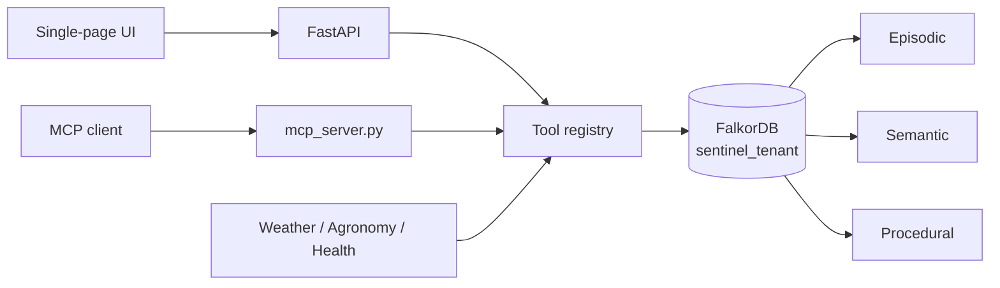
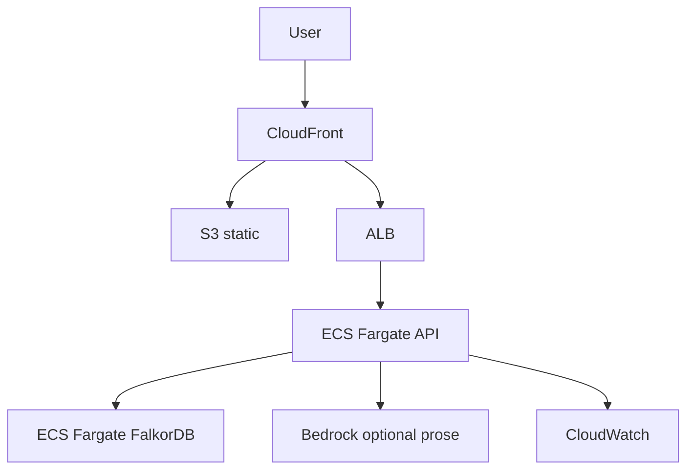

# Architecture

Cascade Sentinel is a graph-native multi-agent system. FalkorDB is not a sidecar: every tool is a Cypher operation.

## Runtime

## Memory layers

| Layer | What lives there | Updated when |
| --- | --- | --- |
| Corridor | Typed causal template (hazard → health) | Seed only |
| Semantic | District profile, GROWS, HAS_GROUP | Seed / tenant switch |
| Signal | Day-one forecasts | Seed |
| Episodic | Episodes, paths, hypotheses, evidence | Each run + close |
| Procedural | Interventions, outcomes, recommendations | close_episode write-back |
| Governance | Officers, teams, sources, approvals | Seed + Approve |

## Production target (AWS)

This repo's demo path is Docker Compose locally (and a small VM + Caddy if deployed). The diagram above is the labelled production target, not what ships in `docker-compose.yml`.
